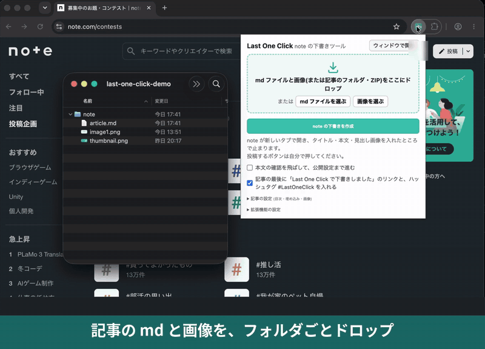

# Last One Click(ラストワンクリック)

**The last one click is yours.** — 下書きまでは拡張が組み立てる。最後のワンクリックは、あなたの手で。

**AI で書いた投稿を、そのまま各 SNS の投稿画面に届けるツール群です。** 整形・画像・タグまで自動で入力して止まります。
**投稿・公開ボタンは絶対に押しません。** 内容を確認して最後の1クリックをするのは、いつも人間です。



使い方の動画(74 秒、音声あり): [YouTube で見る](https://www.youtube.com/watch?v=gB_9mtI3LsU)

**入れ方**:[Chrome ウェブストアで入手](https://chromewebstore.google.com/detail/last-one-click/jomapffkhcdpnodaffobmpfofnnaihnd)(Chrome と Edge などの Chromium 系ブラウザで使えます)。通常はストアから入れてください。ZIP から手で入れる方法は [extension/README.md](extension/README.md) にあります。

**使い方の記事**:[AIが書いた記事から 3ステップでnoteの下書きを作る方法(note)](https://note.com/shibuhachi/n/n9c41926f2a3a)。md の型・AI への頼み方・GitHub から読み込む手順などを、詳しく書いています。

## 使い方

1. note.com にログインしておく
2. ツールバーの拡張アイコンを押し、ポップアップの順に進める(① ② ③ の見出しと「直す」は v0.1.8 から。ストアの v0.1.7 では見出しが無く、② の欄がそのまま出る)
   - **① ファイルを入れる**: md ファイルと画像(記事のフォルダ・ZIP でもよい)を選ぶ。ドロップするときは、先に右上の「ウィンドウで開く」で別のウィンドウにしておく(ツールバーのポップアップは、Finder などに切り替えると閉じるため)
   - **② 入れる内容を確かめる**: md から読んだタイトル・ハッシュタグ・マガジン・価格が出る。直すときは「直す」
   - **③ 下書きを作る**: ログイン中の note アカウントを確かめて、「note の下書きを作成」を押す
3. note のエディタが新しいタブで開き、タイトル・本文・見出し画像・本文の画像が入ったところで止まる。右下のバナーの「公開設定を入れる」で、ハッシュタグ・マガジン(有料記事なら価格も)が入ったところで止まる
4. 内容を確かめて、**自分で「投稿する」を押す**

公開ボタンは**設計上、絶対に押しません**。note には公式の投稿 API がなく、完全自動の公開は利用規約・アカウント凍結のおそれがあるためです。
note の Cookie・パスワードには触れません。ポップアップとバナーに、ログイン中の note アカウントのアイコンと名前を出します(違うアカウントで投稿しないため。保存も送信もしません)。

ポップアップの細かい設定(目次・本文の確認を飛ばす・GitHub から読み込む など)は [extension/README.md](extension/README.md) にあります。

## 記事(md)の書き方

記事ごとにフォルダを作り、`article.md` と見出し画像を入れておくと、フォルダごとドロップできます(ZIP でもよい)。

md の見本(書き換えて使う型と説明)は [templates/note/](templates/note/) にあります。拡張でできることを全部入れてあるので、そのまま読み込んで試すこともできます。

```markdown
---
title: 記事タイトル
hashtags: [AI, 個人開発]
magazine: マガジン名       # 省略可
thumbnail: ./thumbnail.png  # 省略可(1280x670 推奨)
---

## 本文はここから
```

| front matter | 必須 | 備考 |
|---|---|---|
| `title` | △ | 無ければ本文の最初の `# 見出し` を使う |
| `hashtags` | - | 配列 or カンマ区切り。`#` は付けても付けなくてもよい |
| `magazine` | - | note 上のマガジン名と完全一致させる |
| `price` | - | 有料記事の価格(円)。1 以上の整数(`300` など)。公開設定で「有料」を選んで価格を入れる。有料エリア(どこから有料か)は note の画面で決める。本文に `<!-- ここから有料 -->` だけの行を書くと、その行の直前の段落のすぐ下にラインを引く。書かなければ無料のまま |
| `thumbnail` | - | md ファイルからの相対パス |
| `target` | - | (v0.1.8 から)入れる先。書かないか `note` なら note に入れる。それ以外の値(`blog` など。値は自由)を書くと、note の下書きは作らずに止まる。note 以外のサイトに出す記事を、うっかり note に入れないため |
| `note_account` | - | (v0.1.8 から・Chrome 拡張版)記事を作る note のアカウントの ID(`note.com/<ID>` の部分。例: `note_account: example`)。書くと、入力を始める前にログイン中のアカウントと比べ、違えば何も入れずに止める。大文字と小文字・先頭の `@` は区別しない。ログイン中のアカウントが読めないときは止めずに進み、バナーで知らせる。書かなければ比べない |
| `note_url` | - | (v0.1.8 から・Chrome 拡張版)開いている記事の編集画面を書き換えるときの、その記事の URL(`https://note.com/<アカウントの ID>/n/<記事の ID>` か、編集画面の URL)。開いている記事と違えば書き換えない。新しい下書きを作るときは使わない |

### 本文で使える記法

Markdown(GFM)を note のエディタが受け付ける形に変換して貼ります。実機で確認したのは「確認済み」の印のあるものです。

| 記法 | 書き方 | note での扱い |
|---|---|---|
| 見出し(確認済み) | `## ` / `### ` | 大見出し / 小見出し。本文の最初の `# ` はタイトルに使う(front matter に `title` が無いとき) |
| 段落・改行(確認済み) | 空行 / 行末の改行 | 空行で段落。行末の改行もそのまま改行(`breaks: true`) |
| 太字(確認済み) | `**太字**` | 太字。日本語のかぎかっこや句読点を含む形(`**「…」**`)も太字になる |
| 取り消し線 | `~~文字~~` | 取り消し線 |
| 箇条書き・番号リスト(確認済み) | `- ` / `1. ` | リスト |
| 引用(確認済み) | `> ` | 引用 |
| 区切り線(確認済み) | `---` | 区切り線 |
| コード(確認済み) | ```` ``` ```` / `` `code` `` | コードブロック / インラインコード |
| リンク(確認済み) | `[文字](https://…)` | リンク。http(s) と mailto 以外は文字だけ残す |
| 画像(本文中) | `` | URL 指定のみ。手元のファイルは見出し画像としてだけ渡せる |
| 表 | `\| a \| b \|` | **入らない**(note 非対応)。記事を書く側で「表は箇条書きに展開する」と決めておく |
| 斜体 | `*文字*` | note に斜体が無いため文字だけ残る |
| 生の HTML | `` など | 文字としてそのまま表示(安全のため実行しない) |
| HTML コメント | `<!-- メモ -->` | (v0.1.8 から)取り除く(自分用のメモが本文に入らない。コードの中に書いたものは残す。「ここから有料」の印は有料のラインに使い、印として読めない書き方のときは文字のまま出す) |
| 脚注・チェックボックス | `[^1]` / `- [ ]` | 文字として残る |

## 開発する人へ

- **Chrome 拡張の開発・ビルド・ストアに出す手順**: [extension/README.md](extension/README.md)
- **Playwright 版(自分用・開発用。壊れた箇所を Inspector で調べる)**: [docs/playwright.md](docs/playwright.md)
- **記事のリポジトリにマージしたら、手元の PC(Debian)で自動で下書きを作る**: [docs/auto-draft-linux.md](docs/auto-draft-linux.md)(公開はしません)
- **現状と今後の計画**: [docs/ROADMAP.md](docs/ROADMAP.md)。X / TikTok / Instagram も同じ方針(下書きまで作り、投稿は本人のクリック)で順次追加します

拡張と Playwright 版は、`selectors/note.json`(note の画面のセレクタ)を共有しています。

## ライセンス

[MIT License](LICENSE)
