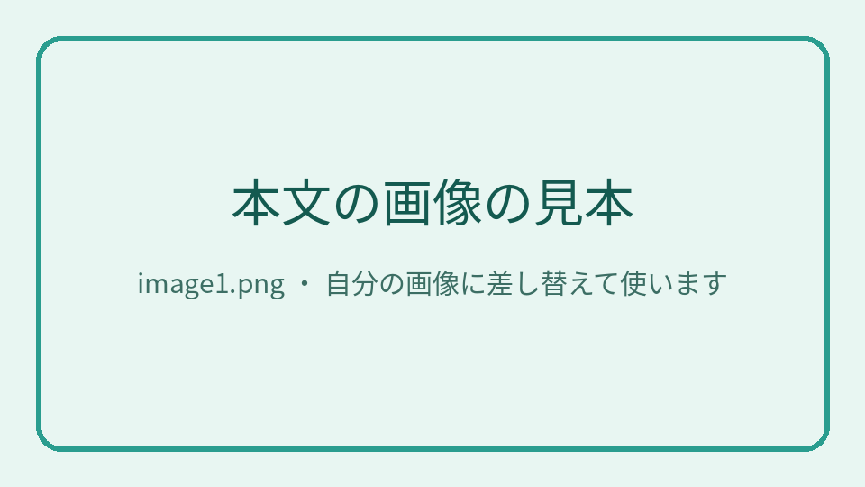
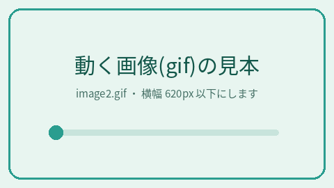

## 最初の見出し

これは見本です。試したら公開せずに下書きを消してください。

本文はここから書きます。段落と段落の間は、空の行を 1 行入れます。

## よく使う書き方

- 箇条書きは「- 」で始めます
- **太字** は「**」で挟みます
- かぎかっこごと太字にした **「この形」** も太字になります

1. 番号付きの箇条書きは「1. 」で始めます
2. 2 つ目

> 引用は「> 」で始めます

### 小見出し

小見出しは「### 」で始めます。[リンク](https://example.com) も使えます。

### コード

文の中の `コード` と、コードのかたまりも入ります。

```
npm test
```

### 自分用のメモ

<!-- この行は自分用のメモです。note の本文には入りません -->
`<!-- … -->` で囲んだ所は、自分用のメモとして読み飛ばされ、下書きには入りません（v0.1.8 から）。コードの中に書いたものは、そのまま入ります。

## 拡張の画面のチェックで入るもの

### 本文の画像

`` のようにファイル名で書いた画像は、本文のその位置に入ります。`` のように `"…"` を書くと、画像の下のキャプションにも入ります。GitHub から読み込んだときは記事と同じフォルダから、手元の md なら一緒にドロップした画像から取ります(1 記事 20 枚まで)。入れたくないときは、「記事の設定」で「本文の画像を入れる」のチェックを外します。



動く画像(gif)も、同じ書き方で入ります。note は横幅 620px より大きい gif を受け付けないことがあるので、横幅は 620px 以下にします。アップロードに時間がかかるときは、拡張は 2 分まで待ちます。



### 埋め込み

URL だけを書いた行は、note の埋め込み（カード）になります。入れたくないときは、拡張の画面の「記事の設定」で「URL だけの行を埋め込みにする」のチェックを外します。

https://chromewebstore.google.com/detail/last-one-click/jomapffkhcdpnodaffobmpfofnnaihnd

### 目次

記事の先頭に note の目次が入ります。目次は、この記事の見出し（`##`・`###`）から note が作ります。入れたくないときは、「記事の設定」で「記事の先頭に目次を入れる」のチェックを外します。

### 最後の 1 行

「記事の最後に『Last One Click で下書きしました』のリンクと、ハッシュタグ #LastOneClick を入れる」にチェックが入っていると(最初はチェックあり)、記事の最後に「この記事は、Last One Click で下書きしました。」の 1 行が入り、ハッシュタグに #LastOneClick が足されます。入れたくないときは、チェックを外します。

---

## 使えない書き方

表は note に入りません。表にしたい内容は、箇条書きにします。
